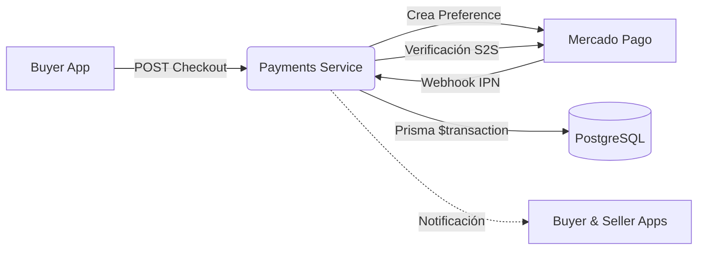

# 💳 CompuLibre — Payments Service


Microservicio de pagos, billetera virtual y liquidación financiera para **CompuLibre** un marketplace de componentes y hardware de computación. Procesa órdenes multi-vendedor integrando **Mercado Pago**, administra saldos y solicitudes de extracción (CBU) para vendedores, y resuelve disputas.

---

## Demo en Vivo

**Link al deploy:** **[proyecto-c-payments-compulibre.vercel.app](https://proyecto-c-payments-compulibre.vercel.app/)**

> Si Clerk solicita código 2FA en el login de prueba, ingresar **`424242`**.

* **Vendedor / Usuario:** `usuario+clerk_test@iaw.com` | `iawuser#` | Ver transacciones, consultar saldo, solicitar retiros bancarios (CBU), abrir tickets de soporte.
* **Administrador:** `administrador+clerk_test@iaw.com` | `iawuser#` | Aprobar/rechazar retiros, gestionar y cerrar disputas, dashboard analítico de volumen.

---

## Arquitectura y Flujo



---

## Características del Sistema

* **Checkout Multi-Vendedor:** Agrupa productos de múltiples vendedores en una sola orden de compra y genera la preferencia de pago en Mercado Pago.
* **Validación Server-to-Server (S2S):** Consulta directamente a la API oficial de Mercado Pago ante cada webhook recibido, verificando el estado real y mitigando la inyección de pagos falsos.
* **Transacciones Atómicas e Idempotencia:** Procesamiento mediante `prisma.$transaction` con filtros condicionales para evitar cobros duplicados y asegurar la consistencia financiera.
* **Billetera Virtual & Retiros (Payouts):** Acreditación de saldo en tiempo real a cada vendedor y sistema de solicitud de transferencias bancarias, auditadas y aprobadas por administradores.
* **Seguridad Inter-Servicios & RBAC:** Control de acceso por roles con Clerk (`user` vs `admin`) y autenticación de endpoints internos mediante encabezados `x-api-key`.

---

## Puesta en Marcha Local

```bash
# 1. Instalar dependencias
npm install

# 2. Configurar variables de entorno
cp .env.example .env

# 3. Base de datos y seed de datos de prueba
npx prisma db push
npm run seed

# 4. Iniciar entorno de desarrollo
npm run dev
```

---

## Documentación de la API (Sandbox)

Para ver el contrato de endpoints, ejemplos con `cURL`, payloads y tarjetas de prueba de Mercado Pago, consultá la [**Guía de Pruebas e Integración**](./docs/guia-uso.md).
